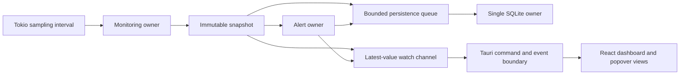

# Architecture: MCS-001

## Overview

- Tauri 2 owns application lifecycle, tray behavior, native plugins, and the typed IPC boundary.
- Rust owns collection, identity, sampling, alerts, persistence, settings validation, and process actions.
- React owns presentation and user interaction but never performs sampling or accesses SQLite directly.
- One canonical owner exists for each behavior; the UI consumes immutable snapshots and explicit command results.

## Key Dependencies

| Capability | Decision | Rationale |
|------------|----------|-----------|
| Desktop shell | Tauri 2 | Native macOS lifecycle, tray APIs, capabilities, and a small application footprint. |
| Process metrics | `sysinfo` 0.39.x | Current cross-platform system and process sampling with explicit refresh semantics. |
| macOS metadata | Targeted platform adapter | Isolates ownership checks and metadata unavailable through the portable collector. |
| Async runtime | Tokio | Interval scheduling, bounded channels, cancellation, and background ownership. |
| Persistence | `rusqlite` 0.41.x with bundled SQLite | Predictable local SQLite version without external runtime installation. |
| Serialization | Serde | One Rust-owned snapshot and command-result contract. |
| Error model | `thiserror` plus `tracing` | Typed user-safe outcomes with diagnostic context that remains local. |
| UI | React and TypeScript | Typed component boundary and testable presentation adapter. |
| UI tests | Vitest and React Testing Library | Fast deterministic component and bridge tests. |
| Integrated E2E | WebdriverIO with `@wdio/tauri-service` | Official Tauri route using an embedded WebDriver server on macOS. |

## Runtime Flow

## Monitoring Owner

- `monitoring.rs` owns the mutable `sysinfo::System` instance and all refresh timing.
- CPU-dependent values are emitted only after enough elapsed time for a meaningful delta; the configured cadence may not violate `sysinfo::MINIMUM_CPU_UPDATE_INTERVAL`.
- `global_cpu_usage()` supplies total-system CPU on a `0..100` all-core scale.
- Process CPU retains the library's per-logical-core convention and may exceed `100` for multi-threaded processes.
- `ProcessKey` is the pair `{ pid, started_at }`; every selection, history row, alert, and action carries the complete key.
- A snapshot is complete and immutable. React never merges independently timed partial metrics.
- A delayed interval greater than twice the configured cadence emits a gap marker and resets sustained-alert continuity.

## Platform Boundary

- `platform/macos.rs` supplies macOS-only ownership checks and metadata that cannot be obtained portably.
- Permission failure is data, not a fatal error; unavailable fields remain optional through the full contract.
- Intel compilation may be attempted, but only macOS 14+ Apple Silicon is a supported verification target.
- Core monitoring never requests administrator privileges, installs a helper, or weakens macOS protections.

## Alert Owner

- CPU alert evaluation is a state machine keyed by `ProcessKey` and rule identity.
- Consecutive valid samples accumulate duration; a gap, identity change, rule change, or below-threshold sample resets continuity.
- Cooldown and allowlist decisions suppress notifications but do not erase existing alert events.
- Memory-growth alert parameters remain disabled until a recorded workload experiment selects a rule and documents false-positive behavior.
- Alert summaries contain observations, thresholds, and windows; no alert text asserts an unobserved cause.

## Storage Owner

- One dedicated blocking worker owns the `rusqlite::Connection`; connections are not shared across async tasks.
- SQLite is opened with bundled SQLite, foreign keys enabled, WAL journaling, a finite busy timeout, and schema version migrations.
- Samples and alert events are inserted in bounded transactions with prepared statements.
- Raw and aggregate retention is pruned after successful batches and at startup.
- The persistence queue is bounded. Saturation or database failure marks storage degraded and records a gap; it cannot grow memory without bound or stop live collection.
- Corruption, lock exhaustion, and migration failure disable persistence for the session and surface a recoverable status without silently recreating or deleting user data.

## Settings Owner

- Settings are deserialized into a versioned structure, validated once in Rust, and atomically replaced only when valid.
- Defaults are 2-second sampling, 80% process CPU, 10-minute duration, 24-hour raw retention, and 7-day aggregate retention.
- Sampling or rule changes reset only affected alert continuity state.
- Notification and autostart states reflect both the saved preference and the current macOS capability.

## Termination Owner

- The frontend submits `ProcessKey`, never PID alone.
- Rust reloads the current process and verifies PID, start time, user ownership, and eligibility after the user confirms.
- The safe default signal is `SIGTERM`; no automatic escalation to `SIGKILL` occurs.
- Cancellation, disappearance, identity mismatch, refusal, and permission failure return distinct typed outcomes.
- Termination remains unavailable until the read-only monitoring slices are verified.

## Bridge Boundary

- `commands.rs` is the only Tauri-facing application API.
- Commands cover current snapshot, history, settings read/write, history deletion, notification state, and termination.
- A typed monitoring event carries the latest immutable snapshot at the sampling cadence.
- `bridge.ts` is the only frontend file importing Tauri APIs; tests inject a fake bridge.
- The capability file grants only required application, event, notification, and autostart permissions. No HTTP plugin is included.

## Presentation Boundary

- `Dashboard.tsx` owns the overview composition and menu-bar-compatible summary content.
- `ProcessExplorer.tsx` owns search, sorting, selection, and process detail presentation.
- `AlertCenter.tsx` owns evidence, dismiss, cooldown, and allowlist interactions.
- `SettingsView.tsx` owns validated settings and local-history deletion confirmation.
- `styles.css` owns the visual tokens: near-black surfaces, green system metrics, blue process indicators, orange warnings, visible focus, and non-color cues.
- Components receive typed data and callbacks; they do not invoke Tauri directly.

## Bootstrap and Tooling

- `tauri.conf.json` sets `com.macsentinel.app`, hides the window rather than exiting when appropriate, and targets macOS 14 or later.
- Tauri setup creates the tray, initializes state, starts background ownership, and wires the main window.
- Left-clicking the tray shows and focuses the main window; menu items open the dashboard or settings and provide an explicit quit action.
- Test-only WebdriverIO plugins are enabled only for the E2E build profile and are absent from production capabilities.

## Security Boundary

- Monitoring data has no network transport and the application declares no HTTP capability.
- Executable paths and process names are treated as display data and never interpolated into shell commands.
- Process actions call platform APIs directly with validated numeric identifiers.
- Logs redact full executable paths by default and never include retained sample payloads unless the user enables local diagnostics.

## Verification Boundary

- Rust integration tests cover sampling semantics, identity, gaps, alert state, bounded storage, retention, settings, and termination races.
- React tests cover rendering, search and sort behavior, accessible state, confirmation, and degraded modes through a fake bridge.
- WebdriverIO exercises the built Tauri application on macOS using the embedded WebDriver provider.
- Performance evidence records idle CPU and resident memory on MacBook Pro `Mac16,7`, Apple M4 Pro, 14 CPU cores, and 48 GB RAM.
- Privacy verification observes outbound connections during normal operation and expects no monitoring-data request.

## Error Philosophy

- Fatal startup errors are limited to failures that make both live monitoring and a truthful UI impossible.
- Optional metadata, notifications, autostart, persistence, and termination degrade independently.
- User-facing errors state the unavailable capability and a safe next action.
- Internal errors retain typed context through `tracing` without exposing sensitive paths in routine UI messages.

## Invariants

- No PID-only history, alert, selection, or action key.
- No UI-owned sampling loop.
- No unbounded queue or history collection.
- No fabricated zero for unavailable process data.
- No alert continuity across a sampling gap.
- No process signal without post-confirmation identity validation.
- No monitoring-data network capability.

## Tradeoffs

- A single SQLite owner favors correctness and bounded coordination over maximum write throughput, which the sampling volume does not require.
- One immutable snapshot event may repeat data, but prevents partial-state races across the Rust and React boundary.
- Bundled SQLite increases binary size while removing dependence on the host SQLite version.
- The WebdriverIO test plugin increases test-build complexity but provides integrated macOS acceptance coverage unavailable from direct `tauri-driver`.

---

Use `architecture.trace.md` for canonical artifact and obligation mappings.
